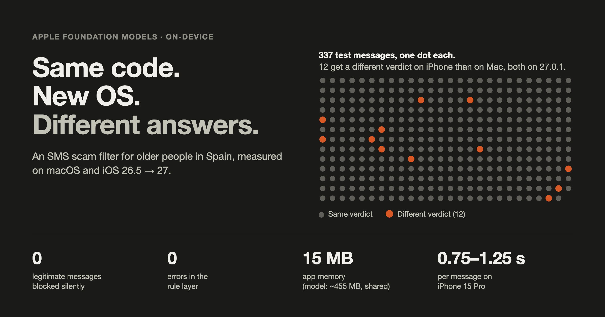

# fm-smishing-bench



A small, reproducible benchmark for detecting SMS scams (smishing) with **Apple's on-device Foundation Models**, compared with open-weight models in the cloud (`gpt-oss` on Groq).

It comes from building an SMS filter that protects older people in Spain. You get the datasets, the exact prompt, the rule layer that runs before the model, a Mac command-line harness, a small iPhone app that runs the same pipeline, a statistics script, and every prediction we measured.

Current target: **macOS 27 / iOS 27**. Results from macOS 26.5 are kept, because the model changed between the two versions.

## Summary: what the data supports, and what it doesn't

Supported by the data in this repo:

- **The on-device model's answers changed with the OS update.** Same code, same prompt, greedy sampling: macOS 26.5 and macOS 27.0.1 give different verdicts on 11 of the 227 hardest messages.
- **On 27.0.1, Mac and iPhone disagree.** 12 of 337 unique messages get a different verdict on an iPhone 15 Pro than on a Mac with the same OS version. On 26.5 they gave identical confusion matrices on the sets we compared.
- **Each device is deterministic on its own.** Repeated runs gave identical predictions (Mac: 3 runs on 27.0.1; iPhone: 4 runs).
- **No refusals or guardrail errors on 27.0.1** on these datasets, with either guardrail setting. On the Mac, the iPhone and Groq, every model answer was literally `JUNK` or `ALLOW`.
- **The rule layer never made a mistake.** It decides 100 of the 337 messages without the model, with 0 errors on every device and OS version. Every error comes from the model.
- **No legitimate message was blocked silently**, on any device or version, because a model verdict can only trigger a warning.
- **Resource use on the iPhone 15 Pro**: about 15 MB in the app, about 455 MB in the system process that runs the model, 0.75 to 1.25 s per message.

Not supported, so we don't claim it:

- **That one model is more accurate than another.** With 227 messages (104 legitimate), none of the differences between Apple FM (26.5 or 27, Mac or iPhone) and `gpt-oss` on Groq are statistically significant. The closest one is false positives on legitimate messages, iPhone 27 vs `gpt-oss-20b`: 9 vs 3, exact McNemar p = 0.07. See [Statistics](#statistics).
- **Real-world accuracy.** The datasets are curated, not real victim traffic.

## What's in the repo

| Path | What it is |
|---|---|
| `data/es_curated.jsonl` | 110 Spanish SMS (55 scam / 55 legitimate). |
| `data/es_adversarial.jsonl` | 65 Spanish SMS (40 / 25) written to get past the defences. |
| `data/es_adversarial_v2.jsonl` | 227 Spanish SMS (123 / 104). **Contains all 65 messages of `es_adversarial`**, plus 162 added later. |
| `data/es_adversarial_v2_added_ids.txt` | The ids of those 162 added messages. |
| `data/uci_sms_spam.jsonl` | 300 English SMS (150 / 150) from the UCI SMS Spam Collection. Generalisation check only. |
| `swift/Pipeline.swift` | The classifier: rule layer + Foundation Models + prompt v3. Shared by the Mac CLI and the iPhone app. |
| `swift/DetectionEngine.swift` | Deterministic "strong" and "medium" scam signals. |
| `swift/main.swift` | Mac CLI: runs a dataset, prints a report, writes CSV and JSON. |
| `ios/` | iPhone/iPad app that runs the same pipeline and measures resources. |
| `python/groq_bench.py` | Same pipeline, but the model layer calls Groq. See [Cloud comparison](#cloud-comparison-groq). |
| `python/stats.py` | Confidence intervals and paired significance tests for any set of runs. |
| `results/reference/` | All our predictions, metrics and logs, one folder per OS version and device, plus the Groq runs. |
| `assets/` | The hero image and the script that builds it from the reference results. |

## Datasets

There are **337 unique Spanish messages**: `es_curated` (110) plus `es_adversarial_v2` (227), which already includes `es_adversarial` (65). No message appears in both `es_curated` and `es_adversarial_v2`. No ids or texts are repeated inside a file.

- **`es_curated`**: bank, parcel, tax office, prizes, utilities, "your son is in trouble", plus hard legitimate cases such as 2FA codes, delivery notices and family messages.
- **`es_adversarial`**: written to beat the filter. Homoglyphs, spaced letters, URLs written as words, code-relay attacks ("an agent will call you, read them the code"), call-back scams, romance, pig-butchering, and legitimate messages that look like scams.
- **The 162 messages added in `es_adversarial_v2`**: more categories, and many more hard legitimate messages (79 of the 162), so the false positive rate has some resolution.
- **`uci_sms_spam`**: a balanced sample of the [UCI SMS Spam Collection](https://archive.ics.uci.edu/dataset/228/sms+spam+collection). It has 6 duplicate texts, which come from the original collection.

Each JSONL line looks like this:

```json
{"id": "adv-s-001", "lang": "es", "label": "scam", "category": "banco", "difficulty": "frontier", "technique": "homoglyph", "text": "..."}
```

**How they were made.** The Spanish messages were written by us, based on smishing campaigns publicly documented in Spain. They are not real messages from victims and contain no personal data. Labels come from a single annotator. A few legitimate messages are genuinely borderline (for example a grandchild asking for a 15 € Bizum), and reasonable people could label them differently.

**Brands, domains and phone numbers.** The scam messages imitate real Spanish brands, because real scams do. The domains (77) and phone numbers (about 20) in the texts were made up for the examples. Some of them may exist or belong to someone. Don't visit or call them.

**Tuning and leakage.** Prompt v3 and the rules were written while looking at `es_curated` and `es_adversarial`, so those two sets are not a clean test. The 162 messages added in `es_adversarial_v2` were written afterwards (one day after prompt v3 was frozen, according to our project notes) and were not used to change the prompt or the rules. On those 162 messages alone, Apple FM scores slightly **higher** than on the full set (see [Results](#results)), so we see no sign of overfitting. You can check any run on just that subset with `python/stats.py --ids data/es_adversarial_v2_added_ids.txt`.

## Requirements

- A Mac with Apple Silicon, macOS 27 or later, and Apple Intelligence turned on
- Xcode 27 or later (for `swiftc` and the FoundationModels SDK)
- For the iPhone app: a device that supports Apple Intelligence (iPhone 15 Pro or later), iOS 27, [XcodeGen](https://github.com/yonaskolb/XcodeGen), and an Apple ID signed in to Xcode
- Optional: Python 3.9+ (standard library only) and a free Groq API key for the cloud comparison

Tested with:

| | Version |
|---|---|
| Mac | Apple M4 (Mac16,12), macOS 27.0.1 (26A434) |
| iPhone | iPhone 15 Pro, iOS 27.0.1 (24A446) |
| Xcode | 27.0 (27A266a) |
| July 2026 runs | Apple M4 Mac, macOS 26.5; iPhone 15 Pro, iOS 26.5 |

## Run it on a Mac

```bash
./run.sh
```

This builds `build/bench` and runs the three Spanish datasets with the production config. Results go to `results/<dataset>_metrics.json` and `results/<dataset>_predictions.csv`. A report is printed with the confusion matrix, false positive rate, latency, which layer decided, model errors, answers that were neither `JUNK` nor `ALLOW`, and every misclassified message.

On the setup above, a fresh clone running `./run.sh` reproduces our reference predictions exactly.

To run a single dataset:

```bash
./build/bench data/es_adversarial.jsonl results/adv
```

The predictions CSV has one row per message: `id, lang, label, category, difficulty, pred, source, correct, ms, errored, unparsed, raw, text`. `source` is the layer that decided (`otp`, `strong` or `model`) and `raw` is the model's raw answer.

### Try the settings that matter

The harness reads three environment variables. The defaults are the production config.

| Variable | Values | What it shows |
|---|---|---|
| `GUARDRAILS` | `permissive` (default), `default` | On macOS 26.5, `default` made the model throw `guardrailViolation` on some of the most dangerous scams. Because the filter fails open, they got through. On macOS 27.0.1 we saw no guardrail errors or refusals with either setting on these datasets. |
| `SAMPLING` | `greedy` (default), `random` | With `random`, the same message can get a different verdict on each run. |
| `PHASE` | `0`, `1` (default), `2` | `0` = OTP rule + model. `1` = also block on strong signals without calling the model. `2` = also inject medium signals into the prompt (we measured this as worse on 26.5). |

```bash
GUARDRAILS=default ./build/bench data/es_adversarial_v2.jsonl results/adv_v2_default_guardrails
SAMPLING=random    ./build/bench data/es_adversarial.jsonl results/adv_random
PHASE=0            ./build/bench data/es_adversarial.jsonl results/adv_phase0
```

## Run it on an iPhone

```bash
cd ios
xcodegen generate
xcodebuild -project FMSmishingProbe.xcodeproj -scheme FMSmishingProbe -configuration Release \
  -destination 'id=<DEVICE_UDID>' -allowProvisioningUpdates -derivedDataPath ../build/ios \
  DEVELOPMENT_TEAM=<YOUR_TEAM_ID> PRODUCT_BUNDLE_IDENTIFIER=<your.bundle.id> build
xcrun devicectl device install app --device <DEVICE_UDID> ../build/ios/Build/Products/Release-iphoneos/FMSmishingProbe.app
xcrun devicectl device process launch --console --device <DEVICE_UDID> <your.bundle.id>
```

The phone must be unlocked when you launch the app. With a free Apple ID you can have at most 3 development apps installed at the same time.

The app runs the three Spanish sets with the production config. It prints one `PRED` line per message (dataset, id, verdict, layer, ms), so you can diff the output against the Mac or feed it to `python/stats.py`. It also reports:

- cold start: the first model call in a fresh process
- model latency per message (p50, p95, max)
- peak `phys_footprint` of the app process (the metric iOS uses to kill apps and extensions)
- CPU time used by the app process
- thermal state and battery level at the start and the end
- model errors and answers that were neither `JUNK` nor `ALLOW`

The model runs in a system process, outside the app, so the app's memory does not include the model. To measure that process, record an Instruments trace while the app runs (the phone needs a cable for this):

```bash
xcrun xctrace record --template 'Activity Monitor' --device "<device name>" --all-processes --time-limit 480s --output activity.trace
```

The app runs in the normal app process, not inside an `ILMessageFilterExtension`.

## Cloud comparison (Groq)

`python/groq_bench.py` runs the same pipeline, but the model layer calls an open-weight model on [Groq](https://groq.com) instead of Foundation Models. The rule layer is ported from Swift to Python. On all 337 Spanish messages, the Python rules decide exactly the same messages as the Swift rules.

### Get a free Groq API key

1. Go to [console.groq.com](https://console.groq.com) and sign in (Google, GitHub or email). The free tier does not ask for a card.
2. Open **API Keys** in the menu ([console.groq.com/keys](https://console.groq.com/keys)) and click **Create API Key**.
3. Give it a name, for example `fm-smishing-bench`, and copy the key. It starts with `gsk_`. Groq shows it only once.
4. Keep it out of the repo. Put it in an environment variable in your shell:

```bash
export GROQ_API_KEY=gsk_...
```

If you want to store it in a file, use `.env` (it is in `.gitignore`) and load it with `export $(grep GROQ_API_KEY .env)`.

### Run it

```bash
# optional: one call to check the key and see your real rate limits
python3 python/groq_bench.py --probe openai/gpt-oss-20b

# full run on the 227-message set
python3 python/groq_bench.py data/es_adversarial_v2.jsonl openai/gpt-oss-20b  results/adv_v2_g20
python3 python/groq_bench.py data/es_adversarial_v2.jsonl openai/gpt-oss-120b results/adv_v2_g120
```

The script uses `temperature 0` and one request per message, like the on-device harness. 167 of the 227 messages reach the model, at about 590 tokens per call (about 100k tokens per run).

On the free tier the binding limit is tokens per minute (8,000 when we ran it), not requests. The script spaces out calls (`GROQ_MIN_INTERVAL_S`, default 8 s), honours `retry-after` on HTTP 429 and stops if the daily limit runs out. With the default interval one run takes about 20 minutes; `GROQ_MIN_INTERVAL_S=5` is still safe at 8,000 tokens per minute. Each model has its own limits, so you can run both models at the same time.

## Statistics

```bash
python3 python/stats.py data/es_adversarial_v2.jsonl \
  mac27=results/reference/2026-10_macos27.0.1/es_adversarial_v2_predictions.csv \
  iphone27=results/reference/2026-10_ios27.0.1_iphone15pro/run1_console.log \
  g20=results/reference/2026-10_groq/adv_v2_g20_run2_predictions.csv
```

It prints accuracy, false positive rate and false negative rate with 95% Wilson intervals, and an exact two-sided McNemar test for each pair of runs (all messages, and legitimate messages only). Add `--ids data/es_adversarial_v2_added_ids.txt` to look only at the 162 later messages.

## How the classifier works

```
SMS ──► Phase 0: genuine one-time code?  ──yes──► ALLOW   (rule, no model)
         │no
         ▼
        Phase 1: strong scam signal?     ──yes──► BLOCK   (rule, no model)
         │no
         ▼
        Foundation Models (prompt v3)    ──JUNK─► WARN    (never a silent block)
                                         ──ALLOW► ALLOW   (or WARN if a medium signal fired)
```

- **Guardrails.** `SystemLanguageModel(guardrails: .permissiveContentTransformations)`. Apple's documentation describes this mode as letting the model handle potentially unsafe content. Requests that generate a `String` don't throw guardrail errors in this mode, but the model can still answer with a refusal message as text. So the harness records the raw answer and counts any answer that is neither `JUNK` nor `ALLOW` (it is treated as `ALLOW`, and reported).
- **Sampling.** `GenerationOptions(samplingMode: .greedy)`, so the same message gets the same answer on the same device and OS.
- **One session per message.** No shared history, the same as an SMS filter extension.
- **Prompt v3** is in Spanish (the messages are Spanish). It lists concrete fraud signals instead of asking the model to "be careful". It is in `swift/Pipeline.swift`.
- **Fail open.** If the model throws or is not available, the message is allowed. A filter must never block a message because of its own error.
- **Two-level action.** The rule layer made no errors in any run, and every error came from the model. So the layer that decided acts as the confidence level. A rule can block silently. The model can only warn.

## Results

### Overview, `es_adversarial_v2` (227 messages: 123 scam, 104 legitimate)

| Model layer | Accuracy [95% CI] | False positive rate [95% CI] | False negative rate |
|---|---|---|---|
| Apple FM, Mac, macOS 26.5 (July) | 93.8% [89.9, 96.3] | 3.8% [1.5, 9.5] | 8.1% |
| Apple FM, Mac, macOS 27.0.1 | 95.2% [91.5, 97.3] | 6.7% [3.3, 13.2] | 3.3% |
| Apple FM, iPhone 15 Pro, iOS 27.0.1 | 93.8% [89.9, 96.3] | 8.7% [4.6, 15.6] | 4.1% |
| `openai/gpt-oss-20b` on Groq (Oct, 2 runs, identical) | 96.5% [93.2, 98.2] | 2.9% [1.0, 8.1] | 4.1% |
| `openai/gpt-oss-120b` on Groq (Oct, 2 runs) | 96.5 to 96.9% | 3.8% [1.5, 9.5] | 2.4 to 3.3% |

The intervals overlap, and no pairwise McNemar test reaches p < 0.05:

| Pair | Messages only A gets right / only B gets right | p (all) | p (legitimate only) |
|---|---|---|---|
| iPhone 27 vs Mac 27 | 3 / 6 | 0.51 | 0.63 |
| Mac 27 vs Mac 26.5 | 7 / 4 | 0.55 | 0.38 |
| iPhone 27 vs Mac 26.5 | 7 / 7 | 1.00 | 0.13 |
| iPhone 27 vs `gpt-oss-20b` | 5 / 11 | 0.21 | 0.07 |
| Mac 27 vs `gpt-oss-20b` | 4 / 7 | 0.55 | 0.22 |

On the 162 messages added after tuning: Apple FM 95.7% on both Mac and iPhone (27.0.1) and 95.1% on 26.5; `gpt-oss-20b` 97.5%; `gpt-oss-120b` 98.1 to 98.8%.

### October 2026: macOS 27.0.1 (Mac)

| Dataset | Accuracy | Recall | False positive rate | Legit blocked silently |
|---|---|---|---|---|
| `es_curated` (110) | 99.1% | 100.0% | 1.8% | 0 |
| `es_adversarial` (65) | 93.8% | 97.5% | 12.0% | 0 |
| `es_adversarial_v2` (227) | 95.2% | 96.7% | 6.7% | 0 |

- Three runs gave identical predictions. No guardrail errors, no refusals, and every model answer was `JUNK` or `ALLOW`, with either guardrail setting.
- Model latency on the Mac: p50 about 300 ms, p95 about 345 ms per message.
- On the 227-message set, 7 legitimate messages were flagged: three 2FA codes, three family Bizum requests and one store pickup notice. All seven become warnings, not silent blocks.

### October 2026: iOS 27.0.1 (iPhone 15 Pro)

| Dataset | Accuracy | Recall | False positive rate | Legit blocked silently |
|---|---|---|---|---|
| `es_curated` (110) | 98.2% | 100.0% | 3.6% | 0 |
| `es_adversarial` (65) | 89.2% | 95.0% | 20.0% | 0 |
| `es_adversarial_v2` (227) | 93.8% | 95.9% | 8.7% | 0 |

- Four runs gave identical predictions. No model errors. Run 4 also checked the raw answers: every one was `JUNK` or `ALLOW`.
- 12 of the 337 unique messages get a different verdict than on the Mac with the same OS version (7 of them legitimate). In July (26.5), the iPhone gave the same confusion matrices as the Mac on `es_curated` and `es_adversarial`. So on 27 you need to test on the device you ship to, not only on the Mac.
- All iPhone false positives came from the model layer, so all of them become warnings, not silent blocks.

**Resource use (app process).** Each run classifies 402 messages (the three sets, so the 65 adversarial messages run twice).

| | Run 1 | Run 2 (phone already warm) |
|---|---|---|
| First model call in a fresh process | 3,659 ms | 1,733 ms |
| Model latency per message, p50 | 751 to 978 ms | 1,034 to 1,111 ms |
| Model latency per message, p95 | 792 to 1,056 ms | 1,172 to 1,432 ms |
| Worst single call | 1,203 ms | 34,642 ms |
| Peak app memory (`phys_footprint`) | 15.0 MB | 15.1 MB |
| App CPU time | 7 to 9 ms per message | 8 to 9 ms per message |
| Thermal state at the end | fair | serious |
| Battery for the whole run (screen on, no cable) | 75% → 70% | 70% → 65% |

- **App memory is not the problem.** The app stays around 15 MB, far below the roughly 120 MB an iOS extension gets.
- **Latency is about 2x what we saw on iOS 26.5** (about 385 ms then), and it grows as the phone heats up. Back-to-back calls pushed the phone to "serious" thermal state, and one call took 34 s. Real SMS traffic is one message at a time, so this is a worst case.
- **Battery:** about 5% for 402 messages in 4 to 6 minutes with the screen on, roughly 0.01% per message. That is an upper bound, because it includes the screen.
- A third run (phone already hot, on a cable and charging) gave the same predictions again, with model latency p50 of 1.17 to 1.25 s.

**The model process.** During the third run we recorded a system-wide Instruments trace (Activity Monitor template, 480 s). It covers 281 model calls plus 2 warm-up calls.

| Process | Role (our reading) | CPU time | Avg CPU | Peak memory footprint | Peak real memory |
|---|---|---|---|---|---|
| `TGOnDeviceInferenceProviderService` | runs the model | 107 s | 15% | 455 MB | 125 MB |
| `aned` | Apple Neural Engine daemon | 84 s | 23% | 8 MB | 38 MB |
| `modelmanagerd` | model lifecycle | 22 s | 6% | 9 MB | 22 MB |
| `modelcatalogd` | model catalog | 22 s | 6% | 6 MB | 12 MB |
| `GenerativeExperiencesSafetyInference` | safety checks | 14 s | 4% | 6 MB | 10 MB |

- **Memory:** the model process needs about 455 MB of footprint on the phone. This is system memory, shared by every app that uses the model, and it does not count against the app or extension limit.
- **CPU:** about 0.38 s of CPU time in the inference service per model call, and about 0.9 s for the whole model stack. These are upper bounds: they also include anything these processes did in the background during the trace. Neural Engine and GPU work is not CPU time and is not in these numbers.
- Spotify was playing during the trace. It does not touch these processes, but it adds load to the phone.

### July 2026: macOS 26.5 / iOS 26.5

Measured on a Mac M4. On an iPhone 15 Pro, `es_curated` and `es_adversarial` gave exactly the same confusion matrices as the Mac (we did not keep per-message iPhone predictions from July). The 227-message set was not run on the iPhone in July.

| Dataset | Accuracy | Recall | False positive rate |
|---|---|---|---|
| `es_curated` (110) | 100.0% | 100.0% | 0.0% |
| `es_adversarial` (65) | 90.8% | 90.0% | 8.0% |
| `es_adversarial_v2` (227) | 93.8% | 91.9% | 3.8% |
| `uci_sms_spam` (300, English) | 78.3% | 70.0% | 13.3% |

On the iPhone 15 Pro (iOS 26.5, app process), peak app memory was about 14 MB and a message took about 385 ms with the system model already loaded. The first load of the model took about 2.4 s.

### What changed between 26.5 and 27

The rule layer decided exactly the same messages in both versions and on both devices. Only the model's verdicts moved: on the 227-message set, 11 verdicts changed on the Mac between 26.5 and 27.0.1. The 27 model missed fewer scams (4 vs 10) and flagged more legitimate messages (7 vs 4), but with this sample size neither change is statistically significant.

Results are deterministic for one OS version on one device, but not across versions, and on 27 not even between Mac and iPhone. If you ship this, treat every OS update as a new model and run your regression set again on the target device.

### What we tried that did not help (macOS 26.5)

These variants were measured during development in July. They are not toggles in this repo, so these numbers can't be reproduced from it.

- **Default guardrails + a simple "when in doubt, ALLOW" prompt.** Recall was 45.5% on `es_curated`, with 8 to 10 guardrail errors. The first prompt was not kept.
- **Structured output (`@Generable`) with chain-of-thought.** On `es_adversarial`, recall went to 97.5% but the false positive rate went to 64%.
- **The model's own confidence score (0 to 100).** Badly calibrated. It said "80 or more" for 42 of 44 messages and was still wrong 14% of the time.
- **Medium signals injected into the prompt (`PHASE=2`).** Recall dropped from 90% to 77% on `es_adversarial`.

## Limits

- **The Spanish datasets are curated, not real victim traffic**, and the labels come from one annotator. They are good for comparing configs and catching regressions, not for claiming real-world coverage.
- **The samples are small.** With 104 legitimate messages, one more false positive moves the rate by about 1 point. Read the intervals, not just the point values.
- **Some scams leave no trace in the text.** Romance, pig-butchering, "call us back" and "an agent will review your case" have no URL and no code. A text classifier can't catch them reliably. They need other layers, such as DNS filtering, number reputation and user education.
- **The prompt is tuned for Spain.** The English UCI set does worse, as expected.
- **Not tested inside a real `ILMessageFilterExtension`.** The iPhone numbers come from the app process.
- **One device per platform.** The 27.0.1 numbers come from one Mac and one iPhone 15 Pro.
- **Groq is not fully deterministic.** With `temperature 0`, `gpt-oss-120b` changed 1 verdict between two runs; `gpt-oss-20b` changed none.

## License

Code: MIT (see `LICENSE`). Spanish datasets: CC BY 4.0. The UCI SMS Spam Collection sample is CC BY 4.0, by Tiago A. Almeida and José María Gómez Hidalgo.
